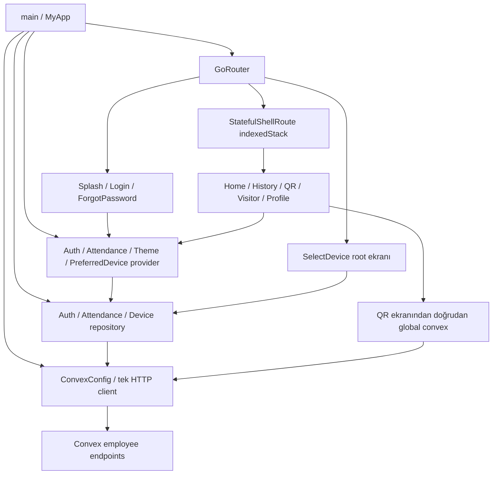

# 08 — Uygulama mimarisi ve navigasyon auditi

Tarih: 19 Ekim 2026. İnceleme mevcut çalışma ağacına aittir; önceden bulunan web/Convex değişiklikleri korunmuştur. Bu çalışma yalnız kaynak okuma ve bu raporun yazılmasından oluşur. Uygulama/backend/platform/test kodu değiştirilmedi; formatlama, bağımlılık kurulumu, Flutter komutu, deploy, commit veya veri mutasyonu yapılmadı.

**Sonuç:** Repository/provider/router ayrımı ve sekme durumunu koruma temeli mevcut. Öncelikli açıklar açık çıkışın kalıcı olmaması ve eski oturumun gecikmiş verisinin yeni oturumda ortak provider'a yazılabilmesidir. Toplam **8 bulgu: P0: 0, P1: 2, P2: 5, P3: 1**. Bulguların kesinliği **kaynak analizi** düzeyindedir; cihazda veya canlı backend üzerinde yeniden üretildikleri iddia edilmemektedir.

## 1. Kapsam, yöntem ve kanıt sınırı

### İncelenen dosyalar

| İnceleme düzeyi | Dosyalar | Amaç |
| --- | --- | --- |
| Tam kapsam | `mobile/lib/main.dart:1–101`, `mobile/lib/router/app_router.dart:1–128`, `mobile/lib/screens/splash_screen.dart:1–164`, `mobile/lib/screens/main_navigation_shell.dart:1–154` | Verilen hedeflerin tamamı; `router/` altında tek Dart dosyası var. |
| Bağımlılık/yaşam döngüsü | `mobile/lib/providers/auth_provider.dart:1–162`, `attendance_provider.dart:1–415`, `theme_provider.dart:1–48`, `preferred_device_provider.dart:1–41` | Oturum, ortak durum, async sonuçlar, polling, tercihler ve disposal. |
| Veri/taşıma sınırı | `mobile/lib/config/convex_config.dart`, `mobile/lib/repositories/auth_repository.dart`, `attendance_repository.dart`, `device_repository.dart` | HTTP, retry, expiry callback, token taşıma ve DI. |
| Ekran entegrasyonları | `mobile/lib/screens/auth/login_screen.dart:22–89,231`, `auth/forgot_password_screen.dart:19–75,163,216`, `home/home_screen.dart:26–38,158–261`, `history/history_screen.dart:21–110`, `profile/profile_screen.dart:163–200,455–479`, `qr_scan/qr_scan_screen.dart:24–153,460–608`, `settings/select_device_screen.dart:17–182`, `visitor/visitor_screen.dart:1–57` | Başlatma, push/go/pop, kullanıcı değişimi, kamera ve placeholder sınırı. Bunlar ekranların tüm işlevlerini kapsayan ayrı audit yerine entegrasyon okumasıdır. |
| Genel `lib` haritası | `mobile/lib/` altındaki 37 Dart dosyasının import/export ilişkileri; `models/{attendance,device,qr_code_model}.dart`, `core/{breakpoints,error_localizer,errors,spacing}.dart`, `theme/app_theme.dart`, `widgets/responsive_container.dart`, `widgets/cards/{attendance_status_card,progress_hero_card,quick_action_card,section_header,stat_card}.dart`, `l10n/app_localizations*.dart` | Katman bağımlılıkları; model/tema/widget/i18n içeriğinin bütün ayrıntıları bu modülün kapsamı değildir. QR veri ayrımı için `models/qr_code_model.dart:37–109` ayrıca okundu. |
| Backend bağlamı | Önce **tamamı** okunan `convex/_generated/ai/guidelines.md`; ardından `convex/lib/employeeAuth.ts:7–23`, `convex/lib/customFunctions.ts:113–134`, `convex/employeeAuth.ts:125–249`, `convex/cardReadings.ts:1352–1450`, `convex/devices.ts:85–149`, `convex/employeeCheckIn.ts:1–29` | Mobil çalışanın kimliği, oturum iptali ve çağrılan endpoint'lerin gerçek olması. Dosyaların ilgisiz yönetim fonksiyonları audit edilmedi. |
| Platform/paket kanıtı | `mobile/android/app/src/main/AndroidManifest.xml:22–49`, `mobile/ios/Runner/Info.plist:25–37`, `mobile/pubspec.yaml`, `mobile/pubspec.lock`, `mobile/.dart_tool/package_config.json` | Özel URL şeması ve yerelde çözümlenen bağımlılık kaynakları. |
| Mevcut test okuması | `mobile/test/providers/auth_provider_test.dart`, `mobile/test/providers/attendance_provider_test.dart`, `mobile/test/widgets/login_screen_test.dart`, `mobile/test/helpers/mocks.dart`; `mobile/test/` dosya/arama envanteri | Provider ve login testlerinin sınırları; eksik test tek başına işlevsel hata sayılmadı. |

Koordinatörün [baz doğrulama kaydı](../evidence/baseline.md) `flutter analyze --no-pub` için “No issues found”, `flutter test --no-pub --reporter expanded` için **44 geçen test** bildiriyor. Bu komutları bu worker çalıştırmadı. Sonuçlar mevcut testlerin geçtiğini gösterir; kamera, OS deep link, sistem geri hareketi, gerçek çalışan oturumu ve fiziksel kapıyı doğrulamaz. Login widget testi `MaterialApp` ile ekranı tek başına kuruyor (`mobile/test/widgets/login_screen_test.dart:14–23`); gerçek `MyApp`/`GoRouter` entegrasyonunu kapsadığı sonucu çıkarılamaz.

Yerel paket kaynakları yalnız kurulu sürümün davranışını okumak için kullanıldı: `go_router 17.2.3`, `mobile_scanner 7.2.0`, `provider 6.1.5+1` (`mobile/pubspec.lock:192–199,336–343,528–535`). Güncel teknoloji veya sürüm tavsiyesi yapılmadığından dış kaynak gerektiren bir iddia yoktur. `.env` içeriği, gerçek parola/token veya kişisel veri okunup rapora alınmadı.

### Gerçek mimari ve bağımlılık haritası

| Katman | Gerçek bağımlılık ve bakım sonucu |
| --- | --- |
| Composition root | `main.dart:44–57` repository'leri ve provider'ları elle kuruyor; router auth provider'ı dinliyor. Bağımlılıkların nerede oluşturulduğu anlaşılır. Ancak `MyApp` dışarıdan bağımlılık kabul etmiyor. |
| Provider | Auth → auth repository + global `convex` + SharedPreferences; Attendance → attendance repository + AuthProvider + Flutter lifecycle; Theme/PreferredDevice → SharedPreferences. İş mantığı ekranlardan kısmen ayrılmış; token durumu için tek DI sınırı henüz yok. |
| Ekran | Home/History → AttendanceProvider; Login/Splash/Profile → AuthProvider; Profile/Home/SelectDevice → PreferredDeviceProvider; SelectDevice → DeviceRepository. QR ayrıca doğrudan `convex.employeeMutation` çağırıyor (`qr_scan_screen.dart:53–56`). |
| Model/core | Modeller JSON dönüşümü yapıyor; `core/errors.dart` taşımadan gelen hataları sınıflandırıyor, `core/error_localizer.dart` UI yerelleştirmesine bağlı. `AttendanceStatusCard` domain durumunu provider dosyasından alıyor (`widgets/cards/attendance_status_card.dart:5`); bu küçük bir katman bağımlılığıdır, tek başına hata değildir. |
| Router/UI sabitleri | Router ekranları import ediyor; Splash/Login/Home/Profile aynı router dosyasından `AppRoute` import ediyor. Böylece ekran ↔ router import döngüsü oluşuyor. Sabitler nedeniyle bugün işlevsel arıza kanıtı yok; rota sözleşmesini küçük ayrı bir dosyaya ayırmak ileride test sınırını sadeleştirir. |
| Ortak görünüm | Tema, spacing, responsive container, kartlar ve üretilmiş TR/EN yerelleştirme ortak kullanımda. Import taraması bütün `lib` dosyalarını kapsar; tüm görsel/çeviri davranışları burada doğrulanmış sayılmaz. |

### Başlatma ve navigasyon akışı

1. `main.dart:17–22`: Flutter binding → `ConvexConfig.initialize()` → `runApp`. Config `.env` yükleme hatasını yakalayıp varsayılan deployment ile client oluşturuyor (`config/convex_config.dart:24–35`); bu davranışın doğru ortamı seçtiği ayrıca doğrulanmadı.
2. `MyApp.initState`: repository/provider'lar bir kez oluşturuluyor; tema ve cihaz bootstrap'ları beklenmeden başlatılıyor; HTTP expiry callback'i auth provider'a bağlanıyor (`main.dart:44–57`).
3. Normal başlangıç adresi `/splash`. **Oturum bootstrap'ını başlatan tek uygulama çağrısı Splash'ta** (`splash_screen.dart:59`). Kayıtlı oturum `me` ile doğrulanıyor; minimum 2,5 saniye bekleniyor; gerekirse hatırlanan bilgilerle yeniden sign-in yapılıyor; sonuç yalnız `/home` veya `/login` oluyor (`splash_screen.dart:59–78`).
4. Splash dışındaki korumalı adreslerde auth false → `/login`; auth true iken login/forgot-password → `/home` (`app_router.dart:49–61`). Splash yönlendirmeden muaf. İlk hedef URI, bootstrap durumu ve dönüş adresi saklanmıyor.
5. Beş kardeş sekme `StatefulShellRoute.indexedStack` altında (`app_router.dart:80–124`). Tab seçimi `goBranch`; aynı tab'a yeniden basmak branch kökünü hedefliyor (`main_navigation_shell.dart:16–21`). Bu, History içindeki filtre/scroll durumunu sıfırlamak veya QR tokenını yenilemek anlamına gelmez.
6. Cihaz seçimi shell dışında root rota; Profile bunu `context.push` ile açıyor (`app_router.dart:76–79`, `profile_screen.dart:187`), seçim sonrası `Navigator.pop` yapılıyor (`select_device_screen.dart:169–175`). Normal push yolunda önceki ekranın korunması tasarımda var. Doğrudan bu rotaya gelişte geri dönüş için açık fallback yok.

### Mevcut capability tablosu

Burada **“çalışıyor” kaynakta tamamlanmış bir bağlantı bulunduğu** anlamındadır; üretim veya cihaz testi sonucu değildir.

| Akış / capability | Durum | Kaynakta görülen gerçek davranış ve sınır |
| --- | --- | --- |
| Composition root ve repository enjeksiyonu | Çalışıyor | `main.dart:44–85`; üç repository + dört provider, auth→attendance proxy güncellemesi. Global client kullanımı nedeniyle izolasyon kısmi. |
| Normal açılışta kayıtlı oturum kontrolü | Çalışıyor | Splash → Auth.bootstrap → repository.me → `employeeAuth:me`; backend session, expiry ve aktif çalışanı doğruluyor. |
| Hatalı/ağsız bootstrap'tan toparlanma | Kısmi | Geçici hata loglanıyor, token korunuyor ama retry/recovery durumu sunulmuyor; AN-F06. |
| Giriş/çıkış ve auth redirect | Kısmi | Gerçek `employeeAuth:signIn/signOut` endpoint'leri bağlı; açık çıkış sonrası remembered credential otomasyonu var, AN-F01. |
| Beş tab'ın Navigator/state korunması | Çalışıyor | Stateful indexedStack ve `goBranch`; yerel filtre/scroll/countdown state'inin widget yaşamı korunuyor. Cihazda doğrulanmadı. |
| Tab gizlenirken kaynakların durması | Kısmi | Attendance app lifecycle'a bağlı; QR kamera için route/tab görünürlük kontrolü yok, AN-F04. |
| Oturum değişiminde veri izolasyonu | Kısmi | Logout listeyi temizliyor ve subscription generation var; doğrudan list/refresh sonuçlarında aynı koruma yok, AN-F02. |
| Mobil deep link girişi | Kısmi | Android/iOS `ngsplus` şeması tanımlı; soğuk oturum restore/hedefe dönüş ve URI normalizasyonu eksik, AN-F03. |
| App Link / Universal Link | Kanıtlanamadı | İncelenen kayıtlarda özel şema var; doğrulanmış HTTP(S) link alan adı/entitlement ilişkisi bu modülde gösterilemedi. |
| Geri hareketi | Kısmi | Forgot password `push`/`pop`, cihaz seçimi `push`/`pop`; shell kökünde sistem geri politikası ve doğrudan açılmış sayfalarda fallback tanımlı değil. OS sonucu manuel doğrulama gerektiriyor. |
| Çalışanın kendi verisine backend sınırı | Çalışıyor | `employeeAuthed*` → `getCurrentEmployee`; readings sorgusu `ctx.employee._id` ile filtreli. Router bir UX sınırı; veri güvenliği backend'de. |
| Cihaz tercihinin kullanıcıya ait olması | Kısmi | Kalıcı cihaz tercihi uygulama genelinde; kullanıcı/proje anahtarı yok, AN-F05. |
| QR üretme ve kart hareketi endpoint'i | Kısmi | QR tokenı gerçek mutation ile üretiliyor; check-in gerçek kayıt yazabiliyor. Bu bağlantı fiziksel kapının açıldığına kanıt değildir: incelenen `selfCheckIn:1383–1448` yalnız erişim değerlendirmesi/kayıt/yanıt içeriyor. |
| Ziyaretçi sekmesi | Placeholder | `visitor_screen.dart:32–44` “Çok yakında” metni; repository/provider/backend çağrısı yok. Navigasyonda görünmesi çalışan ziyaretçi yönetimi demek değildir. |
| Şifre yenileme | Placeholder | `auth_provider.dart:106–110` yöneticiyle iletişim mesajı + `false`; ForgotPassword ekranındaki başarılı gönderim yolu bu implementasyondan tetiklenmiyor. |
| Gerçek cihaz / üretim E2E | Kanıtlanamadı | Bu audit'te uygulama başlatılmadı, canlı kimlik/veri kullanılmadı. |

## 2. İyi çalışan temeller

- Router `build` içinde yeniden yaratılmıyor; aynı `_router` tema değişiminde de kullanılıyor (`main.dart:39,57,88–94`). Auth değişimi `refreshListenable` üzerinden korumalı sayfaların kontrolünü yeniliyor (`app_router.dart:48–61`).
- Kullanıcı kimliği web admin kullanıcısından ayrı çalışan oturumuna dayanıyor. `employeeAuthedQuery/Mutation` istemciden çalışan ID'si almak yerine session üzerinden `ctx.employee` üretiyor (`convex/lib/customFunctions.ts:113–134`); `getCurrentEmployee` expiry/aktiflik doğruluyor (`convex/lib/employeeAuth.ts:11–22`). İncelenen readings listesi yalnız bu çalışanın kayıtlarını seçiyor (`convex/cardReadings.ts:1361–1369`).
- Sekmeler için indexedStack tercih edilmesi History state'ini ve Navigator ömrünü koruyan doğru bir temel. Auth/public ekranları shell dışında; cihaz seçimi ana sekmelerin üzerine ayrı açılabiliyor (`app_router.dart:63–124`).
- Attendance polling'inde generation kontrolü ve iptal mekanizması var (`attendance_provider.dart:151–178,219–226`). Uygulama aktif değilken polling durduruluyor, dönüşte kuruluyor (`243–253`); mevcut provider testi bu temel lifecycle yolunu kapsıyor (`mobile/test/providers/attendance_provider_test.dart:74–118`).
- HTTP query retry/backoff, timeout, hata sınıfları ve idempotent olduğu belirtilmeyen mutation'ları varsayılan tekrar etmeme kararı mevcut (`config/convex_config.dart:98–107,225–286`). “Subscription” burada WebSocket değil, ilk sorgu + zamanlayıcılı polling (`150–223`).
- Repository constructor'larının client alması ve auth/attendance provider'larının repository alması anlamlı test dikişleri sağlıyor. Mevcut testlerin bir kısmı bu sınırları kullanıyor; sorun bu ayrımın bütün global erişimlere henüz uygulanmamış olmasıdır.

## 3. Kanıtlı bulgular

### AN-F01 — Açık çıkış, yeniden başlatmada hatırlanan bilgilerle geri alınabiliyor

**P1 · Kesinlik: kaynak analizi.**

- **Kanıt zinciri:** `mobile/lib/screens/auth/login_screen.dart:63–72` remembered email/password ve otomatik giriş bayrağını yazıyor. Profile çıkışı `AuthProvider.signOut()` çağırıyor (`profile_screen.dart:467–471`). `auth_provider.dart:113–125,142–147` yalnız oturum tokenı/süresini temizliyor. Splash aynı remembered alanlarını okuyup `signIn` çağırıyor (`splash_screen.dart:67–74`). Backend `signOut` yalnız verilen session'ı siliyor (`convex/employeeAuth.ts:212–223`); geçerli parola yeni session üretmeye devam ediyor (`171–185`).
- **Somut tetikleyici:** Kullanıcı “Beni hatırla” ile giriş yapar, profilinden çıkış yapar ve uygulamayı tekrar açar; hesap/parola hâlâ geçerliyken ve ağ ulaşılabilirken.
- **Beklenen / mevcut:** Açık çıkış yeni kullanıcı girişine kadar login durumunu korumalı. Mevcut açılış önce token bulamaz, sonra saklanan bilgilerle yeni session oluşturup `/home`'a gider. Backend logout'un başarısız olması bu davranışın önkoşulu değildir.
- **Etki:** Paylaşılan/başkasına verilen telefonda önceki çalışanın profil ve hareketlerine geri dönülebilir; kullanıcının çıkış niyeti bozulur. Saklanan parola mekanizması bu otomasyonun kaynağıdır; bu rapor fiziksel cihazdan parola çıkarma testi yaptığını iddia etmez.
- **Kök neden:** Oturum sonlandırma ve otomatik giriş tercihi iki farklı katmanda, ortak çıkış sözleşmesi olmadan yönetiliyor.
- **Çözüm:** Explicit logout sırasında otomatik girişi ve eski parola kaydını kaldırmak; remembered e-postayı tutma kararını otomatik girişten ayırmak; parola tekrar oynatma yerine ürünün onayladığı güvenli oturum saklama akışını tek auth servisine taşımak. Expiry ile explicit logout gerekçelerini ayrı modellemek.

### AN-F02 — Eski oturumun gecikmiş liste yanıtı yeni kullanıcının ortak verisine yazılabiliyor

**P1 · Kesinlik: kaynak analizi; zamanlama gerektiren yarış.**

- **Kanıt zinciri:** AttendanceProvider uygulama kökünde tek örnek (`main.dart:79–83`). Logout'ta listeyi sıfırlıyor (`attendance_provider.dart:128–147`), ancak `loadAttendanceRecords()` yalnız **istekten önce** kullanıcı kontrol ediyor ve await sonrası sonucu koşulsuz yazıyor (`256–279`). `_silentRefresh` aynı desende (`231–237`). Repository listesi HTTP çağrısına gider (`attendance_repository.dart:13–17`); client session'ı çağrı anında args'a kopyalar (`config/convex_config.dart:119–128`). Backend o session'ın çalışanına ait listeyi döndürür (`convex/cardReadings.ts:1361–1369`). Subscription callback'lerindeki generation koruması bu iki tek seferlik yola uygulanmıyor.
- **Somut tetikleyici:** A kullanıcısı refresh başlatır; A'ya ait başarılı yanıt yolda gecikir. A çıkar, B giriş yapar; A'nın eski yanıtı B'nin ilk verisinden sonra tamamlanır. Home açılışı/elle yenileme bu isteği başlatabilir (`home_screen.dart:28–37,46–47`).
- **Beklenen / mevcut:** Session değiştikten sonra A'nın yanıtı atılmalı. Mevcut kod A listesini ortak provider'a yazıp dinleyicilere bildirir; B'nin Home/History görünümü bir sonraki başarılı güncellemeye kadar A verisini kullanabilir. Backend'in B'ye A sorgusu yetkisi vermesi gerekmez; hata istemci cache sınırındadır.
- **Etki:** Hareket zamanı/cihaz ve çalışan bilgilerinin hesaplar arasında yanlış görünmesi; katılım durumunun yanlış kullanıcıya ait olması. P1 gerekçesi kişiye ait hareket verisinin kullanıcı değişiminden sonra sunulabilmesidir; üretimde gerçekleşme sıklığı ölçülmedi.
- **Kök neden:** Provider ömrü auth ömründen uzun; bütün async commit'lerde session kimliği/generation kontrolü yok.
- **Çözüm:** Liste, sessiz refresh, mutation sonrası devamlar ve hata/finally durumları için ortak session epoch kullanmak; hesap değişiminde tüm kişiye ait state'i anında temizlemek; eski epoch sonuçlarının state/notify işlemlerini engellemek. Aynı oturumdaki üst üste refresh'lerde de eski yanıtın yeniyi ezmesine karşı istek sırası politikası belirlemek.

### AN-F03 — Deep link, bootstrap'ı atlayabiliyor ve girişten sonra hedef kayboluyor

**P2 · Kesinlik: kaynak analizi; OS URI aktarımı cihazda doğrulanmadı.**

- **Kanıt zinciri:** `main.dart:47–57` AuthProvider oluşturuyor fakat bootstrap çağırmıyor; tek çağrı `splash_screen.dart:59`. Router başlangıcı splash olsa da auth redirect doğrudan protected rota için yalnız bool kontrol ediyor (`app_router.dart:46–60`). Kurulu go_router, platform başlangıcı `/` dışında ise platform rotasını seçiyor (`~/.pub-cache/hosted/pub.dev/go_router-17.2.3/lib/src/router.dart:635–653`). Redirect URI'yi saklamadan `/login` döndürüyor; login ve splash başarıları daima `/home` seçiyor (`login_screen.dart:75–77`, `splash_screen.dart:78`).
- **Somut tetikleyici:** Diskte geçerli session varken soğuk başlangıç rotasının `/history` olması; veya oturum yokken `/qr` hedefinin gelmesi. Platformdan bu route'un gerçek aktarımı manuel matriste doğrulanmalıdır.
- **Beklenen / mevcut:** Önce bir kez session restore, sonra izin verilen orijinal hedefe devam. Mevcut durumda Splash mount edilmezse disk session'ı hiç okunmaz ve login görünür; giriş tamamlandığında hedef `/home` ile değiştirilir. Bu bir yetki atlatma bulgusu değildir.
- **Ek URI/back kanıtı:** Android manifesti `ngsplus://<route>` biçimini tarif eder ve şemayı kaydeder (`AndroidManifest.xml:43–49`); iOS da şemayı kaydeder (`Info.plist:25–37`). Router yalnız `/history` gibi path'ler tanımlar, host→path normalizasyonu yoktur. `ngsplus://history` ile `ngsplus:///history` aynı URI şekli değildir; go_router eşleme `uri.path` kullanır (`go_router-17.2.3/lib/src/match.dart:75,237–240`). `/` ve ürünün kontrollü bilinmeyen-rota ekranı tanımlı değil (`app_router.dart:63–126`). Doğrudan açılmış `/select-device` sonrası seçim yalnız `Navigator.pop` yapar (`select_device_screen.dart:175`); geri stack'i olmayan geliş için ürün fallback'i yoktur.
- **Etki:** Linkle gelmiş kullanıcı gereksiz girişe zorlanabilir, hedef işlem kaybolur; URI biçimine göre eşleşmeyen rota veya geri dönüş belirsizliği oluşur.
- **Kök neden:** Bootstrap görsel Splash widget'ına ait; router'da `initializing/authenticated/unauthenticated` ayrımı ve saklanmış hedef sözleşmesi yok.
- **Çözüm:** Bootstrap'ı composition root/auth controller'a taşımak; Splash'ı bu durumu gösteren ekran yapmak; izinli yerel hedef URI'yi saklayıp auth sonrası tüketmek; tek URI sözleşmesi ve normalizasyon, `/`/bilinmeyen hedef fallback'i, doğrudan açılan modal/sayfa için güvenli geri hedefi tanımlamak. Dış URI'nin keyfi yönlendirme adresi olarak kullanılmasına izin vermemek.

### AN-F04 — Korunan QR sekmesinin gizlenmesi kamera/tarama ömrünü sonlandırmıyor

**P2 · Kesinlik: kaynak analizi; fiziksel kamera sonucu cihazda doğrulanmadı.**

- **Kanıt zinciri:** Shell indexedStack kullanıyor (`app_router.dart:80–105`), `goBranch` ile değişiyor (`main_navigation_shell.dart:16–21`). Kurulu go_router gizlenen branch'i `Offstage` + `TickerMode` ile saklıyor, dispose etmiyor (`go_router-17.2.3/lib/src/route.dart:1678–1697`). QR kendi `MobileScannerController`'ını oluşturup `MobileScanner`'a veriyor (`qr_scan_screen.dart:26,146–153`); görünür branch/route veya app lifecycle kontrolü yok. Controller yalnız ekran dispose'unda kapanıyor (`601–606`).
- **Paket zinciri:** Kurulu `mobile_scanner-7.2.0/lib/src/mobile_scanner_controller.dart:28–29` varsayılan autoStart=true. `mobile_scanner.dart:196–209` barkod dinleyicisini açıp kamerayı başlatıyor; kendi controller'ı verildiğinde widget app-lifecycle observer'ını eklemiyor; durdurma/abonelik iptali dispose yolunda (`213–228`). TickerMode, Dart Timer veya barkod stream iptali değildir.
- **Somut tetikleyici:** QR → Tarama açılıp kamera izni verilir, sonra alt bardan Home/History'ye geçilir; tarayıcı tarafından algılanabilen geçerli bir cihaz QR'ı kameranın önüne gelir. Kaynakta desteklenen base64 cihaz yükü `models/qr_code_model.dart:45–56,78–97` ile üretilebilir. Gerçek cihazdaki tarama devamı ölçülmelidir.
- **Beklenen / mevcut:** Görünmeyen tarama ekranı kamera/detect işlemlerini durdurmalı. Mevcut uygulama kodu branch değişiminde stop veya callback gate göndermiyor; callback geldiğinde `_onDetect` görünürlüğü sorgulamadan `_processQRCode` çağırıyor (`460–478`). Geçerli cihaz akışı `recordAttendance`'a kadar ilerler (`518–526`), backend hareket kaydı yazabilir (`convex/cardReadings.ts:1434–1448`).
- **Etki:** Kullanıcının görünmeyen ekranından beklenmeyen tarama/dialog/kayıt; kamera kaynağının gereksiz açık kalması riski. Bunun fiziksel kapı açtığı veya belirli pil tüketimine yol açtığı test edilmedi.
- **Kök neden:** UI state'ini korumak ile kamera/stream/timer çalışma ömrü aynı kabul edilmiş; shell aktif branch bilgisini QR kaynağına aktarmıyor.
- **Çözüm:** `routeVisible && scanSubtabSelected && appResumed && sessionValid` koşulunu kaynak ömrüne bağlamak; koşul false iken kamerayı durdurmak ve detect'i yok saymak; QR üretim ticker'ını görünürlükle sınırlamak; yeniden görünürken token süresini güncellemek; async finally/dialog devamlarını mounted ve session guard ile korumak. Görsel state korunmaya devam edebilir.

### AN-F05 — Seçili cihaz tercihi kullanıcı değişiminden sonra önceki hesaba ait kalıyor

**P2 · Kesinlik: kaynak analizi.**

- **Kanıt zinciri:** Tercih provider'ı uygulama başında tek kez oluşturulup tüm kullanıcılara veriliyor (`main.dart:49,76–78`). SharedPreferences anahtarlarında çalışan/proje kimliği yok (`preferred_device_provider.dart:7–20`); `clear()` var (`33–39`) ama `mobile/lib` kullanım taramasında çağrısı yok. Logout yalnız auth alanlarını temizliyor (`auth_provider.dart:142–147`). Home önceki adı gösterip ID'yi doğrudan kullanıyor (`home_screen.dart:179–188,225–245`); yeni kullanıcının izinli cihaz listesinin tekrar doğrulanması bu yolda yok.
- **Somut tetikleyici:** A cihaz seçer → çıkış → B aynı uygulamada giriş yapar → Hızlı Aç'a basar.
- **Beklenen / mevcut:** B'nin kendi tercihi veya boş/yeniden seçilmesi gereken durum görünmeli. Mevcut durumda A'nın cihaz adı/ID'si yeni ekranda kalır ve B session'ıyla bu ID'ye istek gider.
- **Etki:** Hesaplar arası cihaz adı bilgisi kalıntısı, yanlış kapı/cihaz hedefleme veya gereksiz red kaydı. **Yetki atlatma kanıtı yok:** backend selfCheckIn mevcut çalışanın grup üyeliğini kontrol ediyor (`convex/cardReadings.ts:1402–1425`). İki çalışanın aynı cihaza yetkisi varsa istek kabul edilebilir; sorun B'nin tercih niyetidir.
- **Kök neden:** Cihaz tercihi auth kapsamına alınmamış, uygulama ayarı gibi saklanmış.
- **Çözüm:** Tercihi çalışan/proje bağlamında saklamak veya logout'ta temizlemek; kullanıcı değişiminde önce belleği boşaltmak; yeni oturumun izinli/aktif cihaz listesiyle doğrulamadan hızlı işlemi etkinleştirmemek; değişen yetki ve silinen cihaz için tekrar seçim durumu sunmak.

### AN-F06 — Geçici bootstrap ağ hatası, geçerli session olmasına rağmen login'e düşürüyor

**P2 · Kesinlik: kaynak analizi.**

- **Kanıt zinciri:** Auth.bootstrap tokenı belleğe/client'a alır (`auth_provider.dart:57–61`); `me()` ağ/servis hatasında yalnız debug log yazar, kullanıcı/recovery state'i kurmaz (`64–68`). `isAuthenticated` hem user hem token ister (`37`). Splash, bu false sonucu login'e yönlendirir veya remembered parola ile sign-in dener (`splash_screen.dart:67–78`). `bootstrap()`/`_repo.me()` çağrı taramasında ağ geri geldiğinde, login ekranında veya app resume'da tekrar restore yolu yok. Attendance lifecycle yalnız kendi listesini yönetiyor (`attendance_provider.dart:243–253`).
- **Somut tetikleyici:** Geçerli saklı session, remembered otomatik giriş kapalı, soğuk açılışta `me` sorgusunun retry'ları boyunca ağ yok; sonra login ekranında ağ geri gelir.
- **Beklenen / mevcut:** Kullanıcı açıkça “oturum doğrulanamıyor” durumunu ve tekrar denemeyi görebilmeli; session geçersizliğiyle ağ hatası ayrılmalı. Mevcut durumda token silinmez ama restore'u yeniden başlatan UI yok; kullanıcı parola girmeye veya uygulamayı yeniden başlatmaya yönelir.
- **Etki:** Geçici ağ sorunu yanlışlıkla giriş gereksinimi gibi görünür; kapı önündeki ana akışta toparlanma zorlaşır. Bu rapor çevrimdışı yetkili işlem sunulmasını önermiyor.
- **Kök neden:** Bool auth modeli `not initialized`, `temporary failure` ve `unauthenticated` durumlarını ayıramıyor; Splash hata/retry sözleşmesi taşımıyor.
- **Çözüm:** AN-F03'teki bootstrap durum makinesine tekrar denenebilir hata eklemek; sınırlı/tekilleştirilmiş retry ve açık girişe geçiş sunmak. Ayrıca Splash'ın beklenmeyen init hatalarını görünür başarısızlık durumuna çevirmek: `splash_screen.dart:56–79` genel catch/finally içermiyor, prefs okumaları da bootstrap'ın catch'i dışında (`auth_provider.dart:41–58`). Bu ikinci yol yalnız hata-enjeksiyonu ile doğrulanmış bir dayanıklılık hedefi olmalıdır; mevcut cihaz arızası sayılmaz.

### AN-F07 — Eski isteğin expiry sinyali yeni session'ı temizleyebiliyor

**P2 · Kesinlik: kaynak analizi; zamanlama gerektiren yarış.**

- **Kanıt zinciri:** Employee isteği tokenı çağrı anında args'a alıyor (`config/convex_config.dart:119–128,133–146`). Eski istek sonradan `AuthExpiredError` alırsa `_call` herhangi bir token/session karşılaştırması olmadan global callback çağırıyor (`237–240`). Callback yalnız güncel auth provider'ı tanıyor (`main.dart:53–55`); `handleAuthExpiry` mevcut client/session/user bilgisini temizliyor (`auth_provider.dart:132–147`). Callback tipi hata veren token/epoch taşımıyor (`config/convex_config.dart:54–56`).
- **Somut tetikleyici:** A'nın isteği açıkken A çıkar, B giriş yapar; A'nın iptal edilmiş/süresi dolmuş tokenına ait hata B girişinden sonra döner. Subscription callback generation koruması taşıma katmanında daha önce yayılan bu global sinyali engellemez.
- **Beklenen / mevcut:** Yalnız hata veren session hâlâ aktifse logout yapılmalı. Mevcut hata B'yi `/login`'e atabilir; B tokenı geçerli olsa bile yerel session silinir. Aynı hesabın yeniden girişinde de eski token/yeni token ayrımı gerekir.
- **Etki:** Başarılı girişin hemen bozulması, tekrar giriş döngüsü ve erişim akışının kesilmesi; burada yetkisiz erişim iddiası yok.
- **Kök neden:** Taşıma hatası global yan etkiye çevrilirken isteğin session bağlamı kayboluyor.
- **Çözüm:** Expiry bildiriminde request session epoch'unu taşımak ve auth controller'da güncellik kontrolü yapmak; aynı session için concurrent expiry temizliğini tekilleştirmek; eski işlerin cancellation/epoch politikasını AN-F02 ile paylaşmak. Provider seviyesindeki ek `handleAuthExpiry` çağrıları da aynı kurala uymalı (`attendance_provider.dart:209–211,268–269,335–336`).

### AN-F08 — Composition root sahipliği ve DI sınırı tamamlanmamış

**P3 · Kesinlik: kaynak analizi; bakım/izolasyon bulgusu.**

- **Kanıt zinciri:** `main.dart:44–57` kaynakları oluşturuyor; `dispose:61–64` yalnız AuthProvider ve router'ı kapatıyor. Theme/PreferredDevice `.value` ile sunuluyor (`75–78`); bu constructor otomatik dispose bağlamıyor (yerel `provider-6.1.5+1/lib/src/change_notifier_provider.dart:119–130`). HTTP client global `_client` içinde tutuluyor ve `http.Client` oluşturuyor (`config/convex_config.dart:16,35,58–72`); kapatma API'si yok, expiry callback'i root dispose'unda kaldırılmıyor. AuthProvider enjekte repository kullansa da tokenı global `convex` üzerinden yönetiyor (`auth_provider.dart:58,81,100,123,134`); QR ekranı doğrudan aynı globale gidiyor (`qr_scan_screen.dart:53–56`).
- **Somut tetikleyici:** `MyApp` testte/host yeniden kurulumunda kaldırılır veya bağımsız client ile ikinci app kapsamı kurulmak istenir; geç kalan HTTP/auth işi eski root'un callback'ine bağlı kalabilir. Normal OS process kapanışında kalıcı bellek sızıntısı ölçülmüş değildir.
- **Beklenen / mevcut:** Oluşturma/kapama ve session saklama tek sahipte olmalı; fake client bütün ağ/auth akışını izole etmeli. Mevcut root eksik disposal yapıyor ve injected repository ile global client'ın aynı örnek olması örtük varsayım.
- **Etki:** Gerçek router + bootstrap entegrasyonunu test etme maliyeti artar; gelecekte client/config değiştirme veya app yeniden kurulumunda eski callback/notifier riski oluşur. P3 seçimi mevcut kullanıcı arızasının ölçülmemesindendir.
- **Kök neden:** DI kısmi; session/transport ve UI ömrünün sahibi açık kontrata bağlanmamış.
- **Çözüm:** Session store ve client'ı aynı composition kapsamından enjekte etmek; QR için repository/service sınırı koymak; owned notifier/router/client callback'leri için simetrik kapama ve in-flight invalidation tanımlamak; bağımsız `AppRoute` sözleşmesiyle UI/router döngüsünü azaltmak.

## 4. Ayrıntılı geliştirme iş paketleri

Boyutlar **S/M/L göreli kapsam tahminidir**, takvim veya kesin gün taahhüdü değildir. Testler uygulanacak anlamlı senaryolardır; bu audit sırasında eklenmedi/çalıştırılmadı. Ortak auth/session işleri ilgili modül sahipleriyle tek uygulama altında birleştirilmelidir; bulgu sayısından bağımsız aynı işi iki kere geliştirmemek gerekir.

### AN-WP01 — Açık çıkış ve otomatik giriş sözleşmesi

- **İlgili bulgu / öncelik:** AN-F01, P1.
- **Kapsam:** AuthProvider, login remembered akışı, Splash auto sign-in ve kalıcı oturum store'u. Backend'in mevcut session iptali korunarak mobil çıkış niyeti tamamlanır.
- **Bağımlılıklar:** Ürün kararı: hatırlanan e-posta explicit logout'tan sonra kalabilir mi; parola kaydından geçiş politikası. AN-WP07'nin store enjeksiyonu yararlı fakat ilk düzeltme ona engellenmemeli.
- **Yapılacaklar:** Explicit logout/expiry ayrımı; otomatik giriş iznini açık çıkışta kaldırma; eski parola verilerini güvenli geçişle silme; token ve remembered giriş devamlarını session sürümüyle yönetme; logout sunucu hatasında da yerel niyeti koruma.
- **Gözlemlenebilir kabul:** Hatırla açık giriş → çıkış → process restart dizisinde login görünür ve kendiliğinden sign-in isteği atılmaz. Backend logout ulaşılmazken de aynı sonuç alınır. Kalıcı store'da eski remembered parola alanı kalmaz. Kullanıcı tekrar açıkça giriş yapabilir.
- **Anlamlı testler:** Başarılı logout, timeout/logout hatası, session zaten iptal edilmişken logout, restart ve açık oturum yenileme senaryoları; HTTP fake ile otomatik sign-in çağrı sayısının sıfır olması.
- **Tahmin:** **M** — UI/persistence/auth sınırları ve eski kayıt geçişi birlikte ele alınacak.

### AN-WP02 — Session'a bağlı async sonuç ve expiry izolasyonu

- **İlgili bulgular / öncelik:** AN-F02 (P1), AN-F07 (P2).
- **Kapsam:** Session epoch, AttendanceProvider'ın liste/refresh/mutation devamları, HttpConvexClient expiry bildirimi ve auth temizliği.
- **Bağımlılıklar:** Auth lifecycle'ın tek epoch sahibi olması; AN-WP03 bu sözleşmeyi tüketir. AN-WP07 ile DI API'si uyumlandırılmalı.
- **Yapılacaklar:** Her isteğe session epoch yakalama; auth değişiminde epoch artırma ve kişiye ait state'i temizleme; await sonrası başarı/hata/finally commit'lerinde güncellik kontrolü; aynı session'da refresh sırası politikası; global expiry sinyalini session bağlamıyla sınırlama ve tekilleştirme; dispose sonrası sonuçları atma.
- **Gözlemlenebilir kabul:** A'nın geciken listesi B ekranında hiçbir frame'de görünmez. A'nın geç expiry cevabı B'nin geçerli session'ını silmez. Aynı kullanıcının yeni tokenı da eski token hatasından korunur. Güncel tokenın gerçek expiry'si korumalı ekrandan login'e yönlendirir. Logout sonrası geç yanıt boşaltılmış cache'i dolduramaz.
- **Anlamlı testler:** Completer/fake HTTP ile A-success → B-login → A-response; A-request → logout → B-login → A-expired; aynı hesap yeni session; iki refresh'in ters sırada bitmesi; widget/provider unmount sırasında sonuç; subscription ve manuel refresh'in aynı anda tamamlanması.
- **Tahmin:** **L** — Taşıma, auth, veri provider'ı ve bütün async yollar boyunca ortak invariant gerekiyor; yeni endpoint eklenirken de uygulanabilir olmalı.

### AN-WP03 — Bir kez çalışan bootstrap, deep link ve geri dönüş politikası

- **İlgili bulgu / öncelik:** AN-F03, P2.
- **Kapsam:** `main`, router, Splash, login başarı devamı; native özel şema sözleşmesi ve root ekranların back davranışı.
- **Bağımlılıklar:** Session epoch sözleşmesi (AN-WP02); ürünün destekleyeceği URI'ler ve sekme kökünde sistem geri politikası. AN-WP04 aynı bootstrap durum modeline eklenmeli.
- **Yapılacaklar:** Bootstrap'ı widget mount'undan bağımsız, idempotent Future/durum yapısına taşıma; initialising için guard; güvenli return-to hedefi; URI biçimi/host/path normalizasyonu; `/` ve bilinmeyen adres ekranı; doğrudan açılmış forgot-password/select-device için geri fallback; root/global Navigator anahtarlarını gerçek kullanımına göre sadeleştirme (`shellNavigatorKey` şu an yalnız tanımlı: `app_router.dart:23–25`).
- **Gözlemlenebilir kabul:** Normal açılışta ve her desteklenen cold deep link'te restore tam bir kez çalışır. Geçerli session `/history` hedefinde açılır; geçersiz session login sonrası aynı izinli hedefe döner. Bilinmeyen/izin verilmeyen URI kontrollü fallback verir. Hedef query parametreleri karara uygun korunur. Doğrudan açılmış cihaz seçimi geri/başarılı seçimle güvenli uygulama ekranına döner. Logout sonrası sistem geri korumalı veriye dönmez.
- **Anlamlı testler:** Router/widget testinde platform başlangıç rotası, auth üç durumu, bekleyen bootstrap, login/forgot-password/splash route yenilemesi, bilinmeyen URI, tekrarlanan link, auth sırasında yeni hedef; Android back ve iOS edge-swipe manuel testi. `ngsplus://history` ve `ngsplus:///history` için kabul edilen biçim açıkça test edilir.
- **Tahmin:** **L** — Router, auth state, native URI sözleşmesi ve iki platform geri davranışını ortaklaştırıyor.

### AN-WP04 — Bootstrap hata ve yeniden deneme deneyimi

- **İlgili bulgu / öncelik:** AN-F06, P2.
- **Kapsam:** Restore sonucu, Splash/error UI ve yeniden deneme. Çevrimdışı yetki verilmesi kapsam dışıdır.
- **Bağımlılıklar:** AN-WP03'ün merkezi bootstrap modeli; HTTP katmanının mevcut hata sınıfları.
- **Yapılacaklar:** Geçici hata/invalid session ayrımı; kullanıcının tetikleyebildiği retry; aynı anda tek restore; hata durumunda hedefi koruma; beklenmeyen prefs/model/init hatalarını görünür duruma çevirme; loglarda hassas veri içermeyen olay/reason ölçümü; minimum animasyon beklemesinin ürün ihtiyacını değerlendirme.
- **Gözlemlenebilir kabul:** NetworkError/Timeout/5xx sonunda “tekrar dene” durumu görünür; geçerli token kendiliğinden silinmez, ağ dönünce retry mevcut session'ı doğrular ve hedefe götürür. AuthExpired sonucu login'e gider. Preferences hatası sonsuz spinner/uncaught Future ile kalmaz. Çoklu retry tek aktif bootstrap üretir.
- **Anlamlı testler:** Geçerli session + geçici me hatası + başarılı retry; expired me; depolama exception; bozuk profil payload'ı; retry sırasında dispose; retry sırasında logout/deep link. Canlı sisteme istek atmayan fake store/client kullanılmalı.
- **Tahmin:** **M** — AN-WP03'ün durum modeline dayanan belirli hata dalları ve UI kabulü var.

### AN-WP05 — Sekme görünürlüğüne bağlı QR kaynak ömrü

- **İlgili bulgu / öncelik:** AN-F04, P2.
- **Kapsam:** Shell aktif index'i, QR iç tab'ı, kamera controller/stream/ticker ve app lifecycle. QR domain güvenliği ayrı modül kapsamıyla eşgüdümlenmeli.
- **Bağımlılıklar:** Shell→branch görünürlük sinyali; session değişim sözleşmesi (AN-WP02); native kamera fake'i ve gerçek cihaz erişimi.
- **Yapılacaklar:** Görünürlük + app state + iç sekme + session'dan tek active koşulu; stop/start ve detect gate; izin ekranından dönüşü ele alma; aktif olmayan ekranda timer redrawing'i durdurma; yeniden görünürken expiry değerlendirme; async işlemlerin mounted/session guard'ı.
- **Gözlemlenebilir kabul:** QR taramadan diğer alt sekmeye geçince kamera stop alır; gizli durumda enjekte edilen barcode kayıt mutation'ı ve dialog üretmez. Arka plana geçişte aynı sonuç; dönüşte yalnız görünür scan tab'ı kamerayı başlatır. History scroll/filter state'i korunur; QR görsel state korunurken expired token geçerli gösterilmez.
- **Anlamlı testler:** Fake kamera controller çağrı sayısı; QR→Home→QR, Scan→MyQR, settings overlay, izin reddi/geri dönüş, expired session, in-flight detection sırasında logout. İki gerçek cihazda kamera göstergesi ve backend test ortamı kayıt sayımıyla doğrulama.
- **Tahmin:** **M** — Sınırlı ekran/kaynak sahipliği; native izin/lifecycle kombinasyonları nedeniyle yalnız widget testi yeterli değil.

### AN-WP06 — Çalışan kapsamlı cihaz tercihi

- **İlgili bulgu / öncelik:** AN-F05, P2.
- **Kapsam:** PreferredDeviceProvider, auth geçişi, Home hızlı işlem ve cihaz seçimi.
- **Bağımlılıklar:** Çalışan/proje kimliği; `devices:listForEmployee` gerçek yetki listesi; explicit logout politikası (AN-WP01).
- **Yapılacaklar:** Tercih anahtarına sahiplik ekleme veya logout'ta temizleme; eski global kaydı başka kullanıcıya otomatik taşımama; kullanıcı değişiminde synchronous memory clear; yeni oturumda izinli listeyle doğrulama; cihaz silinmesi/yetki kaldırılması için görünür seçim durumu; loading/error sırasında yanlış hedefe istek engeli.
- **Gözlemlenebilir kabul:** A→B geçişinde A'nın adı/ID'si B arayüzünde görünmez ve B işlemi A'nın eski tercihiyle başlamaz. Seçim izinli listeden doğrulanana kadar hızlı işlem kapalı/yeniden seçim durumunda olur. İzin kaldırılan/silinen cihaz yeniden seçim ister. Tema tercihi etkilenmez.
- **Anlamlı testler:** Aynı cihazda iki hesap, farklı proje, aynı hesaba restart, legacy global key, listede artık olmayan cihaz, doğrulama sırasında hesap değişimi; fake repository ile gönderilen ID/session eşleşmesi.
- **Tahmin:** **M** — Persistence geçişi ve async yetki doğrulaması içerir.

### AN-WP07 — Kaynak sahipliği ve bütünleşik test dikişi

- **İlgili bulgu / öncelik:** AN-F08, P3.
- **Kapsam:** Composition root, client/session store enjeksiyonu, QR repository sınırı, router factory ve kapama protokolü.
- **Bağımlılıklar:** AN-WP02/03 API kararları; iyileştirme için büyük framework değişimi zorunlu değil.
- **Yapılacaklar:** `MyApp` veya app scope'u için açık bağımlılık paketi; auth token değişikliklerini aynı injected client/store'a bağlama; QR client çağrılarını repository'ye taşıma; owned notifier'ları dispose etme, expiry callback'ini kaldırma, client kapama/in-flight invalidation; her router instance için Navigator key sahipliğini belirleme; `AppRoute` sabitlerini ekran import'larından ayırma.
- **Gözlemlenebilir kabul:** Gerçek router/bootstrap kullanan test tamamen fake client/store ile ve gerçek ağ açmadan kurulabilir. Aynı test sürecinde iki bağımsız app kapsamı token/callback/key paylaşmaz. Unmount sonrası callback/state bildirimi olmaz; kaynaklar tam bir kez kapatılır. Tema değişiminde router/branch kimliği korunur.
- **Anlamlı testler:** mount→async init→unmount→late response; bağımsız iki scope; tekrar mount; theme toggle; auth expiry callback unregister; tab state ve route hedeflerinin korunduğu smoke akışı. Sadece dispose satırlarının aynısını kontrol eden test yerine gözlemlenen davranış sınanmalı.
- **Tahmin:** **M** — Mevcut constructor enjeksiyonu başlangıç sağlıyor; global erişimlerin tek tek taşınması gerekiyor.

Önerilen uygulama sırası: **AN-WP01 ve AN-WP02** ile oturum sınırı; ardından **AN-WP03/04** ile açılış/rota sözleşmesi. AN-WP05/06 bu ortak session API'sini kullanır; AN-WP07 bakım iyileştirmesi olarak birlikte veya sonrasında yürütülebilir. Bu bir iş takvimi veya başka worker başlatma talimatı değildir.

## 5. Manuel cihaz / E2E doğrulama matrisi

**Bu tablodaki bütün senaryolar bekliyor; bu worker tarafından çalıştırılmadı.** Android ve iOS gerçek cihazları, ayrılmış test çalışanları ve test deployment'ı kullanılmalı. Gerçek kapı/üretim verisiyle mutation bu audit'in parçası değildir. Kayıtlarda token/parola veya kişisel veri tutmadan istek türü, sentetik kullanıcı etiketi, aktif rota ve kayıt sayısı yeterlidir.

| ID | Ortam / hazırlık | İşlem | Beklenen gözlem / kanıt |
| --- | --- | --- | --- |
| AN-M01 | Android + iOS; session yok | Normal başlat, login, beş tab arasında dolaş | Bootstrap bir kez; login sonrası home; her hedefin aktif tab eşleşmesi; korumalı hedefe giriş öncesi veri render edilmemesi. |
| AN-M02 | Geçerli saklı session; remembered parola yok | Process'i kapat/aç | Profil me ile doğrulanır; parola sorulmadan doğru kullanıcı açılır; bir restore ve sınırlı ilk liste isteği ölçülür. |
| AN-M03 | Hatırla açık sentetik hesap | Giriş → explicit logout → process restart | AN-WP01 sonrası login'de kalır, otomatik sign-in yok; sunucu logout timeout'u ile tekrar edilir. Mevcut kusuru yeniden üretmek için de aynı tetikleyici. |
| AN-M04 | İki sentetik hesap; proxy/fake gecikme | A refresh'i geciktir, logout, B login, A yanıtını serbest bırak | A verisi hiçbir B ekranında görünmez; B cache/route'u değişmez. Geciktirilen expiry yanıtıyla ayrıca B session'ının korunması izlenir. |
| AN-M05 | Geçerli session; ağ kapalı | Soğuk aç, ağ geri gelsin, retry | Geçici hata açıkça gösterilir, session korunur; tekrar parola gerektirmeden restore olur. Retry sırasında deep link hedefi de korunur. |
| AN-M06 | Android/iOS; cold + warm; session valid/invalid | `/history`, `/qr`, `/select-device`, `/forgot-password` için özel şema linkleri; hem host hem path biçimi | Kabul edilen URI biçimi belgelenir; restore/giriş sonrası hedef korunur; reddedilen biçim kontrollü hata verir. OS'den alınan gerçek rota gözlemlenir. |
| AN-M07 | Korumalı route + overlay açık | Backend test session'ını geçersizleştir, istek tetikle; ardından sistem geri | Login'e tek geçiş; arkadaki dialog/korumalı shell/veri geri gelmez; concurrent expiry ile döngü yok. |
| AN-M08 | History'de seçilmiş filtre, scroll ve iç tab | Home/QR/Profile arasında geç, History'ye dön; seçili alt tab'a tekrar bas | Tanımlanan state korunur; yeniden basmanın branch kökü davranışıyla filtre/scroll reset beklentisi açıkça ayrılır. |
| AN-M09 | QR scan açık, izin verilmiş | Home'a geç; test QR'ı göster; sonra arka plana/ön plana dön | Gizli branch'te kamera/detect kapalı, hareket kaydı/dialog yok; geri dönüşte yalnız aktif scan kamerayı açar. Kamera göstergesi ve test backend kayıt sayısı kontrol edilir. |
| AN-M10 | QR tokenı oluşturulmuş | Başka tab'da token süresinden uzun bekle, QR'a dön | Süresi geçmiş token geçerli görünmez; yenileme gereksinimi anlaşılır; gizli ticker sürekli UI güncellemesi üretmez. |
| AN-M11 | A seçili cihazlı; B'nin yetki listesi farklı | A logout → B login → Home hızlı işlem | A cihaz adı/tercihi görünmez; B'ye ait doğrulanmış seçim olmadan yanlış cihaza istek yok. Cihaz silme/yetki kaldırma varyantı uygulanır. |
| AN-M12 | Android sistem geri; iOS kenardan geri | ForgotPassword push; Profile→SelectDevice push; doğrudan linkle SelectDevice; her tab kökü | Normal push önceki ekrana döner; stacksiz açılış güvenli fallback kullanır; kök tab geri davranışı ürün kararıyla eşleşir; boş ekran/kırık pop yok. |
| AN-M13 | Preferences/model hata enjeksiyonu; yavaş başlangıç | Restore, tema ve cihaz bootstrap hataları; app kapanışı sırasında sonuç | Sonsuz splash/uncaught callback yok; hata/retry görünüyor; unmount sonrası eski scope state'ine erişim yok. |
| AN-M14 | Authenticated; ziyaretçi/şifre akışı | Ziyaretçi tab'ı ve ForgotPassword aç | Placeholder açıkça anlaşılır; başarılı davet/parola maili yapılmış gibi sunulmaz. Bu capabilities ayrı geliştirme kararı bekler. |

## 6. Açık sorular ve kapsam dışı sonuçlar

1. Özel şemada desteklenecek kanonik URI biçimi nedir; `ngsplus://history` mi, `ngsplus:///history` mi, yoksa host + path mi? Android/iOS gerçek `defaultRouteName` örnekleri sentetik linklerle kaydedilmeli. App/Universal Link gereksinimi var mı?
2. Explicit logout remembered e-postayı tutabilir mi; otomatik giriş hangi durumda tekrar etkinleşmeli? Şifre saklamadan oturum devamlılığı için ürün politikası kesinleştirilmeli.
3. Cihaz tercihi çalışan/proje başına mı, fiziksel telefona mı ait olmalı? Mevcut metin “kullanıcının tercih ettiği cihaz” diyor (`preferred_device_provider.dart:4`); telefona aitse yeni kullanıcıya açıkça onaylatılmalı.
4. Sekme kökünde Android geri Home'a mı dönmeli, uygulamadan mı çıkmalı? Aynı tab'a tekrar basınca filtre/scroll sıfırlanması isteniyor mu? Kod branch köküne dönmeyi uygular; tüm widget state'ini sıfırlamayı vaat etmez.
5. QR ekranı görünmezken token ömrü korunacak, yenilenecek veya kullanıcıya yenileme mi sunulacak? Kamera hiçbir görünmeyen branch'te aktif kalmamalı; bu karar token UI state'inden ayrı tutulmalı.
6. `/visitor` placeholder tab'ı tüm çalışanlara gösterilmeye devam edecek mi? Mobilde web admin rolleri yerine çalışan oturumu var; bu audit router'da admin rol kontrolü olmamasını tek başına açık saymaz. Ziyaretçi özelliği geliştirilecekse yetki sözleşmesi backend ile ayrıca tasarlanmalı.
7. “Hızlı Aç” ürün iddiası fiziksel röle/kapı komutunu kapsıyor mu? İncelenen mobil endpoint zinciri gerçek kart hareketi yazıyor; bu rapor fiziksel aktüatör çalışmasını onaylamaz. İlgili cihaz/backend modülüyle kabul kapsamı birleştirilmeli.
8. Uygulama henüz başlatılmadan config okunamaması durumunda varsayılan deployment kullanımı istenen ortam politikası mı? Gerçek deployment uygunluğu ve release yapılandırması bu modülde doğrulanmadı.

**Teslim sınırı:** Yalnız bu Markdown raporu yazıldı. Önerilen kod/test iş paketleri uygulanmadı; cihaz, canlı session, üretim deep link ve fiziksel kapı doğrulamaları bekliyor.
